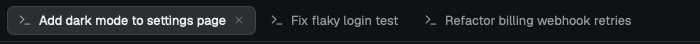

# claude-tabs

A [Herdr](https://herdr.dev) desktop app mod: tabs that take the title Claude Code gives each conversation.



- A tab with a Claude Code pane is renamed to the conversation title, with Claude's status glyph stripped. The full title is stored (so the sidebar and `herdr-app ls` show it whole); the tab cuts it visually.
- Placeholder titles are skipped: "Claude Code", and the folder name Claude shows until it picks a topic.
- With several Claude panes in one tab, the focused one wins.
- Renames follow title changes right away (on render), with a 5 s fallback timer.
- Rename a tab yourself and the mod leaves it alone. Rename it to `""` (clear the name) to hand it back.
- Everything else is Herdr's own tab bar (`tabs` 0.1.12), with tab labels up to 260px wide instead of 170px.

It runs no programs, reads no files and makes no network requests. It only uses `panes()`, `spaces()`, `shared()` and `run("tab.rename")`.

## Install

```sh
git clone https://github.com/aolmosj/herdr-claude-tabs
cp -r herdr-claude-tabs/mods/claude-tabs ~/.config/herdr-app/mods/

# Herdr restores its shipped layouts on start, so use your own copy
herdr-app do layout.clone '{"name":"main","as":"my-main"}'
sed -i.bak 's/"mod": "tabs"/"mod": "claude-tabs"/' ~/.config/herdr-app/layouts/my-main.json

herdr-app check ~/.config/herdr-app/mods/claude-tabs
```

If you already have your own layout, point its tab bar (`"mod": "tabs"`) at `claude-tabs` instead.

Notes:

- Herdr only notices a **new** mod folder on start. After copying it the first time, restart the app or switch to another layout and back (Ctrl+Shift+L).
- **Don't symlink** `~/.config/herdr-app/mods/claude-tabs` to a clone of this repo: Herdr doesn't hot-reload through a symlink. Copy the folder (re-run the `cp` after `git pull`).
- `herdr-app check` runs without live data, so it proves the mod loads, not that it renames anything. Try it with a Claude Code tab open.

## Uninstall

Switch back to the `main` layout (Ctrl+Shift+L), then delete `~/.config/herdr-app/mods/claude-tabs` (and `layouts/my-main.json` if you made it for this).

## Limits

- Only Claude Code panes (OSC 7501 `app` = `claude-code`) are used. Other agents keep their names.
- The mod only runs in layouts that use it as their tab bar.
- Based on Herdr's `tabs` mod 0.1.12. It is a clone, so it won't pick up later changes to the shipped tab bar.

## License

Apache-2.0. `main.js` and the SVGs are derived from Herdr's `tabs` mod ([herdrdev/herdr-app](https://github.com/herdrdev/herdr-app), Apache-2.0); see [NOTICE](NOTICE).
