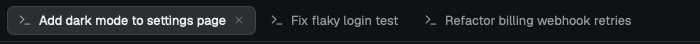

# Claude tabs

Herdr's tab bar, with tabs that take the title Claude Code gives each conversation. Open Claude in a tab and, as soon as Claude names the conversation, the tab shows that name. Tab names can be up to 260px wide before they are cut off with "…". If you rename a tab yourself, the mod leaves it alone.

## What you see

The bar runs across the top of the work area, in a layout block 42px high (`id: "tabs"`, `window_drag: true`). From left to right:

- **Tabs** for the active space, in a row that scrolls sideways when full. Each tab is 29px high, with 10px side padding, a 7px gap between its parts, 7px rounded corners and 12.8px text. It shows:
  - the program's icon (14px): tinted with `muted` if the program's icon is tinted, otherwise full colour;
  - the name, at most 260px wide, cut off with "…"; " Z" is added while the tab is zoomed;
  - a status mark (see below);
  - on the active tab only, a 12px close icon in `dim`.
- **+** (26px square button).
- **Files** and **Changes** buttons (26px high, 8px side padding, 12px text, 14px icon), if those panels are enabled.
- **Minimize, maximize and close** buttons (26px square), only when `window().buttons` is set; on Windows they use the mod's own `win-*.svg` icons (16px).

On macOS with `titlebar: "none"`, the bar's left padding clears the traffic lights (at least 10px).

Colours are theme names. The bar is `chrome` with a 1px `border` line along its bottom edge. The active tab is `raised` with a 1px `border` outline and `foreground` text. Other tabs are `chrome` with a `chrome` outline and `muted` text. Hovering a tab or button shows `hover`. An open Files or Changes panel shows its button in `selected`.

### Tab names

| Tab | Name | Example |
|---|---|---|
| Has a Claude Code pane with a topic | the terminal title Claude sets, without its leading spinner or ✳, whitespace collapsed, in full | Fix flaky login test |
| Claude has no topic yet ("Claude Code", or the folder name) | unchanged | Claude Code |
| No Claude Code pane | Herdr's default: the name, or the program's name if unnamed | Terminal |

With several Claude panes in one tab, the focused one names it, else the first.

## How it behaves

- **Agent status** on each tab, using the most urgent status of the agents in it:
  - working: a 12px spinner (`mods/workspace-chrome/spinner.svg`) in `working`, turning once every 900ms;
  - blocked: a 6px dot in `blocked`;
  - done: a 6px dot in `done`;
  - idle: no mark.
- **Click** a tab to select it. **Double-click** to rename it. **Right-click** opens the shipped `menu` mod as a 200px popup.
- **Drag** a tab by pressing on it and releasing on another tab: it moves to that tab's position.
- **Scroll** over the bar to go to the previous or next tab.
- **+** opens the shipped `new-menu` mod as a 250 × 512px popup.
- **Files / Changes** open that panel, or close it if it is already showing. Each space remembers which panel was open.
- **Renaming:** a tab is renamed only when nobody named it, it still has a default name ("Claude Code", "Claude" or the program's name), or it still has the name the mod last gave it. Once you rename it, it keeps your name. Renaming it to "" hands it back.
- Renames happen on the next render after a title changes, and at the latest within 5 seconds.

## Built from

- `mods/claude-tabs/main.js`: a clone of Herdr's shipped `tabs` mod 0.1.12 (`mod.clone {name: "tabs", as: "claude-tabs"}`) with three changes:
  - `render()` calls `syncTabNames()` first;
  - `init(_props, cx)` starts `cx.timer.every(5000, () => syncTabNames())`;
  - the name's `max_w` goes from 170 to 260.
- `mods/claude-tabs/names.js`: `syncTabNames()` and `cleanTitle(raw, cwd)`.
  - Reads `spaces()` (each tab's `id`, `name`, `named`) and `panes()` (`tab`, `terminal`, `app`, `title`, `cwd`, `focused`, `program.name`).
  - Only panes with `app === "claude-code"` count.
  - Calls `run("tab.rename", {id, name})`.
  - Remembers the names it gave in `shared("claude-tabs.owned")`, a map of tab id to name. Drops tabs that no longer exist; writes with `setShared` only when the map changes.
  - Keeps an in-memory map of renames sent but not yet visible, so a render doesn't re-send them; an entry expires after 5 s so a failed rename is retried.
- `mods/claude-tabs/mod.json`: `{ "place": "none", "title": "Claude tabs", "cloned_from": { "name": "tabs", "version": "0.1.12" } }`.
- Layout: a clone of `main` (`layout.clone {name: "main", as: "my-main"}`) with the `tabs` block's `"content": { "mod": "claude-tabs" }`.
- Inherited from `tabs`, unchanged: `openOverlay`, `theme`, `window`, `layout`, `settings`, `localStorage` key `panels`, shared key `workspace.panels`, layout nodes `sidebar`, `panel`, `panel-body`, the `menu` and `new-menu` mods, icons `mods/pane/close.svg`, `mods/files/file.svg`, `mods/changes/changes.svg`, and commands `tab.select`, `tab.move`, `tab.close`, `tab.prev`, `tab.next`, `layout.show`, `layout.hide`, `layout.select`, `window.minimize`, `window.maximize`, `window.close`.
- It runs no programs, reads no files and makes no network requests. No keys.

## Watch out

- **Placement.** It replaces the tab bar, so `place` is `none`. Herdr restores its shipped layouts on start, so clone one first and point the clone's `tabs` block at this mod.
- **A new mod folder needs a reload.** Herdr only notices it on start: restart, or `layout.switch` away and back.
- **Don't symlink** the mod folder into `mods/`: Herdr doesn't hot-reload through a symlink.
- **`herdr-app check` runs without live data:** `panes()` and `spaces()` are empty, so it proves the mod loads, not that it renames anything.
- **`tab.rename` sets `named`**, so after the first rename the mod can't tell its names from yours by `named` alone. That is why it stores the names it gave.
- **`tab.rename` isn't visible in `spaces()` at once.** Without the in-flight map, every render until then re-sends it.
- **Claude's early titles.** Until Claude picks a topic its title is "Claude Code" or the folder name; both are skipped, so the tab keeps its default name.
- **Full titles are stored.** Don't cut the title before renaming: the sidebar and `herdr-app ls` would show the cut name.
- **Only Claude Code.** Other agents' tabs keep their names.
- **Runs only while the bar is in the layout.** If a layout shows the bar twice, both copies rename; the second finds nothing to do.

## Done when

- `herdr-app check mods/claude-tabs` passes.
- The tab bar looks and behaves like Herdr's own, except that a long name runs to 260px before "…".
- In a new space, a new tab running Claude Code takes the conversation's title within 5 seconds of Claude setting it.
- A tab you rename by double-clicking keeps your name while its title changes.
- Renaming that tab to "" makes the mod name it again within 5 seconds.
- `shared("claude-tabs.owned")` lists only tabs that still exist.
